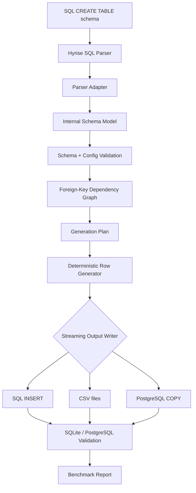

# SchemaForge

A modular C++ relational test-data generation engine: parse SQL CREATE TABLE schemas, model relational constraints, generate deterministic constraint-valid datasets, stream SQL/CSV/PostgreSQL COPY output, and validate generated data with SQLite or PostgreSQL.

SchemaForge is an educational systems project for practicing C++ beyond syntax: parser integration, internal domain modeling, constraint validation, graph-based dependency ordering, deterministic generation, streaming writers, database-backed correctness checks, and benchmark reporting.

## Table of contents
-   [Architecture](#architecture)
-   [Features](#features)
-   [Stack and dependencies](#stack-and-dependencies)
-   [Project structure](#project-structure)
-   [Build](#build)
-   [Web workspace and HTTP API](#web-workspace-and-http-api)
-   [Testing](#testing)
-   [Quick demo](#quick-demo)
-   [Configuration](#configuration)
-   [Output formats](#output-formats)
-   [Validation](#validation)
-   [Generation model](#generation-model)
-   [Benchmarks](#benchmarks)
-   [Supported SQL and types](#supported-sql-and-types)
-   [Troubleshooting](#troubleshooting)
-   [Limitations and future work](#limitations-and-future-work)
-   [Extending the codebase](#extending-the-codebase)
-   [Statistics](#statistics)
-   [License and references](#license-and-references)

## Architecture

### Layers

-   **CLI** — `init` creates editable configs; `generate` runs the generation pipeline.
-   **Parser adapter** — wraps Hyrise SQL Parser and converts parser output into SchemaForge domain objects.
-   **Schema model** — represents tables, columns, SQL types, keys, unique constraints, foreign keys, nullability, and checks.
-   **Config model** — loads generation settings, output settings, validation settings, row counts, and column controls.
-   **Validation** — validates schema references, type compatibility, config correctness, constraint support, and generation feasibility.
-   **Dependency graph** — orders tables by foreign-key dependencies.
-   **Generation plan** — prepares table/column generation based on constraints and config.
-   **Typed generators** — generate deterministic values for supported SQL types.
-   **Output writers** — stream rows to SQL INSERT, CSV, or PostgreSQL COPY.
-   **Database validation** — optionally imports generated output into SQLite or PostgreSQL.
-   **Benchmark engine** — records rows, timing, throughput, output size, validation time, and memory usage.



### Design choices

-   **Parser boundary**: external parser structures are converted once into internal C++ objects instead of leaking parser-specific types across the codebase.
-   **Domain model first**: generation operates on SchemaForge's own table, column, type, and constraint model.
-   **Dependency-first generation**: parent tables are generated before child tables by topologically ordering the foreign-key graph.
-   **Deterministic output**: seed-based generation makes results reproducible across runs.
-   **Streaming writers**: large datasets are written row-by-row instead of requiring all rows to be buffered before output.
-   **Validation before side effects**: unsupported schemas and impossible configs are rejected before output files are opened.
-   **Database-backed correctness**: generated data can be imported into real databases so real constraints verify correctness.
## Features

### Schema parsing and relationship modeling

-   Parses SQL CREATE TABLE schemas.
-   Uses the vendored Hyrise SQL Parser as the SQL parsing frontend.
-   Converts parser output into SchemaForge's internal C++ domain model.
-   Models tables, columns, SQL types, primary keys, unique constraints, checks, nullable columns, and foreign keys.
-   Supports single-column and composite primary keys.
-   Supports single-column and composite unique constraints.
-   Supports foreign keys that reference primary-key or unique columns.
-   Builds a foreign-key dependency graph and generates parent tables before dependent child tables.
-   Rejects invalid schemas and impossible generation configurations before output is written.

### Constraint-aware generation

-   Generates deterministic data from a configurable seed.
-   Supports default row counts and per-table row counts.
-   Supports per-column numeric ranges, fixed value lists, and null probabilities.
-   Supports nullable single-column foreign keys.
-   Supports composite foreign-key null behavior by making the complete local tuple NULL together.
-   Registers generated parent primary-key / unique-key values as key sources.
-   Samples child foreign keys from valid parent key sources instead of generating unrelated random values.
-   Performs finite-domain capacity checks for unique constraints.
-   Supports simple CHECK constraints:
    -   numeric ranges
    -   BETWEEN
    -   numeric IN
    -   text IN

### Output, validation, and benchmarking

-   Streams SQL INSERT output.
-   Streams one headered CSV file per table.
-   Streams transactional PostgreSQL COPY FROM STDIN output.
-   Optionally validates generated SQL in SQLite.
-   Optionally validates SQL, CSV, and PostgreSQL COPY output using a temporary PostgreSQL Docker container.
-   Writes benchmark metrics for rows, generation time, throughput, output size, validation time, total command time, and Linux peak RSS memory.

## Stack and dependencies


| Component | Details |
 |---|---|
 | Language | C++ |
  | Build system | CMake, plus a convenience Makefile |
   | SQL parser | Vendored Hyrise SQL Parser under `external/sql-parser` | 
   | Config | YAML via yaml-cpp | 
   | SQLite validation | SQLite runtime + development headers | 
   | PostgreSQL validation | Docker + temporary `postgres:17-alpine` container | 
   | Primary platforms | Linux, Arch/Manjaro, Ubuntu/Debian, macOS | 
   | Main binary | `schemaforge` |

## Project structure

```
schemaforge/
├── CMakeLists.txt
├── Makefile
├── README.md
├── LICENSE
├── docs/
│   └── architecture.md
├── examples/
│   ├── final_demo/                 # End-to-end demo configs, schema, output samples, benchmarks
│   └── benchmarks/                 # Large benchmark fixtures
│       ├── single_table_1m/
│       ├── users_orders_1m/
│       └── ecommerce_large/
├── external/
│   └── sql-parser/                 # Hyrise SQL Parser submodule
├── include/
│   └── schemaforge/
│       ├── benchmark/              # Benchmark reporting interfaces
│       ├── config/                 # YAML generation config model
│       ├── domain/                 # Column/domain resolution
│       ├── generator/              # Typed value generation and generation plans
│       ├── graph/                  # Dependency graph / ordering logic
│       ├── io/                     # File and stream helpers
│       ├── output/                 # SQL, CSV, PostgreSQL COPY writers
│       ├── parser/                 # Parser adapter boundary
│       ├── schema/                 # Table, column, type, and constraint model
│       └── validation/             # Schema/config/database validation
├── src/
│   ├── benchmark/
│   │   └── BenchmarkEngine.cpp
│   ├── config/
│   │   └── GenerationConfig.cpp
│   ├── domain/
│   │   └── ColumnDomainResolver.cpp
│   └── generator/
│       ├── BooleanGenerator.cpp
│       ├── DecimalGenerator.cpp
│       ├── GenerationPlan.cpp
│       └── IntGenerator.cpp
├── scripts/
│   ├── run_benchmarks.sh
│   ├── run_integration_tests.sh
│   └── run_postgres_validation_tests.sh
├── server/                        # FastAPI interface to the C++ CLI
├── web/                           # React and TypeScript workspace
├── benchmark-results/              # Generated benchmark artifacts, ignored by Git
├── schemaforge.yaml                # Example/generated config
├── benchmark.yaml                  # Example/generated benchmark report
└── output.sql                      # Example/generated SQL output

```

Generated directories such as `build/`, `benchmark-results/`, `.cache/`, and `.git/` are not part of the source design.

## Build

Clone the repository with submodules:

```bash
git clone --recurse-submodules git@github.com:Jaysurya85/schemaforge.git
cd schemaforge

```

If the repository was cloned without submodules:

```bash
git submodule update --init --recursive

```

Install system dependencies before configuring CMake.

**Ubuntu / Debian**

```bash
sudo apt update
sudo apt install cmake g++ make libyaml-cpp-dev sqlite3 libsqlite3-dev

```

**Arch / Manjaro**

```bash
sudo pacman -S cmake gcc make yaml-cpp sqlite

```

**macOS with Homebrew**

```bash
brew install cmake yaml-cpp sqlite

```

Configure and build:

```bash
cmake -S . -B build
cmake --build build

```

CMake builds the bundled Hyrise SQL Parser library before linking the schemaforge binary.

For a fully clean rebuild:

```bash
rm -rf build
cmake -S . -B build
cmake --build build

```

Optional install:

```bash
cmake --install build
schemaforge --help

```

Install somewhere writable without sudo:

```bash
cmake --install build --prefix "$HOME/.local"
"$HOME/.local/bin/schemaforge" --help

```

## Web workspace and HTTP API

The local website uses the same C++ CLI as the command line workflow. A FastAPI
server runs the CLI for each request and exposes the same API to the browser or
to `curl`. The website supports SQL schema inspection, row and column controls,
SQL/CSV/PostgreSQL COPY output, preview, download, and the engine's validation
results. It is designed for a laptop demo and binds to loopback by default.
After inspecting a schema, the optional AI planner can turn a testing goal into
reviewable controls and YAML. It only proposes settings the current engine can
validate; unsupported distribution requests are shown as unapplied. Generation
still runs through the local C++ engine. AI planning requires a server-side
`OPENAI_API_KEY` and sends the schema, current settings, and testing goal to
OpenAI. Manual generation works without a key.

After building the CLI, start the API from the repository root:

```bash
python3 -m venv server/.venv
server/.venv/bin/pip install -e 'server[test]'
server/.venv/bin/uvicorn schemaforge_api.app:app --app-dir server --host 127.0.0.1 --port 8000
```

In a second terminal, start the frontend:

```bash
cd web
pnpm install --frozen-lockfile
pnpm dev
```

Open `http://127.0.0.1:5173`. Vite forwards `/api` calls to the FastAPI server.
For a single-server demo, run `pnpm build` in `web/` first, then open
`http://127.0.0.1:8000`; FastAPI serves the built frontend if `web/dist` exists.
Set `SCHEMAFORGE_BINARY` when the CLI is outside `build/schemaforge`, and see
[server/README.md](server/README.md) for the HTTP contract and a `curl` example.

On macOS, if this checkout still contains parser objects or `libsqlparser.so`
from a Linux build, run `make -C external/sql-parser clean` before building the
native CLI. A fresh clone does not need that extra step.

## Testing

Run the integration test suite:

```bash
scripts/run_integration_tests.sh

```

Valid test outputs and benchmark reports are written to:

```
tests/artifacts/

```

Run real PostgreSQL import tests for both CSV and PostgreSQL COPY output:

```bash
scripts/run_postgres_validation_tests.sh

```

The PostgreSQL validation script exits successfully with a skip message when Docker is unavailable.

## Quick demo

Check the local build:

```bash
./build/schemaforge --help

```

Create an editable generation config from a schema:

```bash
./build/schemaforge init \
  --schema examples/final_demo/schema.sql \
  --config schemaforge.yaml \
  --seed 42 \
  --default-rows 1000

```

Generate data from the config:

```bash
./build/schemaforge generate --config schemaforge.yaml

# Check schema, config, and generation feasibility without writing output
./build/schemaforge validate --config schemaforge.yaml

```

SchemaForge parses the schema, validates relationships and generation settings, builds a foreign-key dependency order, generates deterministic rows, streams the selected output format, and optionally validates the result.

For a compact end-to-end demo covering SQL, CSV, PostgreSQL COPY, validation, deterministic output, constraints, foreign-key ordering, composite keys, and benchmark reporting, see:

```
examples/final_demo/

```

For the internal pipeline and design rationale, see:

```
docs/architecture.md

```

## Configuration

`init` writes an editable YAML config containing the schema path, dialect, seed, row counts, output settings, benchmark settings, validation settings, and per-table/per-column controls.

Minimal example:

```yaml
schema: schema.sql
dialect: sqlite

generation:
  seed: 42
  default_rows: 100

output:
  format: sql
  file: output.sql

benchmark:
  file: benchmark.yaml

validation:
  sqlite: true
  postgres: false

```

Supported dialects:

-   `sqlite`
-   `postgres`

### Column controls and realistic data

Realistic generation is opt-in and deterministic. Related fields in the same generated row share one profile, so names, emails, phone numbers, and city/state/ZIP values remain coherent. No external faker library or system clock is used; the same seed produces the same output.

```yaml
generation:
  seed: 42
  default_rows: 100
  realistic: true

tables:
  users:
    rows: 100
    columns:
      age:
        min: 18
        max: 80
      status:
        values: [active, inactive]
      middle_name:
        null_probability: 0.4

```

Column control rules:

-   `min` and `max` apply to numeric columns.
-   `values` accepts YAML scalar values and converts them to the target SQL type.
-   `null_probability` must be between 0.0 and 1.0.
-   `null_probability` may only be used on nullable, non-key columns.
-   Nullable single-column foreign keys may be NULL.
-   For composite foreign keys, configuring one local column makes the complete tuple NULL together.
-   Column settings are validated against SQL types and CHECK constraints before output is opened.
-   Settings on parent PRIMARY KEY or UNIQUE columns define the registered key source used by child foreign keys.
-   Local foreign-key columns may only set `null_probability`.
-   Explicit SQL constraints and column settings take precedence over name-based realistic-data heuristics.
-   When `realistic` is omitted or false, SchemaForge uses deterministic placeholder generation.

## Output formats

### SQL INSERT output

Default SQL output writes INSERT statements to a single SQL file.

```yaml
output:
  format: sql
  file: output.sql

```

Behavior:

-   Uses standard single-quote string escaping.
-   Uses `true` / `false` booleans.
-   Uses double-quoted identifiers for SQLite and PostgreSQL dialects.
-   Preserves deterministic seed behavior.
-   Can be validated with SQLite or PostgreSQL, depending on dialect and validation settings.

### CSV output

Set the output format and directory:

```yaml
output:
  format: csv
  directory: output/

```

Generate normally:

```bash
./build/schemaforge generate --config schemaforge.yaml

```

Behavior:

-   Each table is streamed to its own file, such as `output/users.csv` and `output/orders.csv`.
-   Files include a header in schema column order.
-   Rows retain generation order.
-   Missing output directories are created automatically.
-   `output.directory` is required for CSV configs.
-   Text containing commas, quotes, carriage returns, newlines, or surrounding whitespace is quoted.
-   Embedded quotes are doubled.
-   NULL is written as an empty field.
-   Empty text is written as `""`.
-   Booleans use `true` / `false`.
-   Decimals use two fractional digits.
-   Date/time values use the same padded formats as SQL output.
-   SQLite validation is skipped for CSV because the SQLite validator executes SQL statements.
-   Benchmarks still report rows, throughput, memory, and combined CSV output size.

### PostgreSQL COPY output

Use `postgres_copy` to create one self-contained data file for `psql`:

```yaml
dialect: postgres

output:
  format: postgres_copy
  file: output.copy.sql

validation:
  sqlite: false

```

Generate and import:

```bash
./build/schemaforge generate --config schemaforge.yaml
psql --dbname your_database --file output.copy.sql

```

Behavior:

-   Target tables must already exist.
-   Output is wrapped in one transaction.
-   Tables are emitted in foreign-key dependency order.
-   Rows use PostgreSQL text COPY format.
-   Fields are tab-separated.
-   NULL is written as `\N`.
-   Backslashes and control characters are escaped.
-   Table and column identifiers are double-quoted.
-   `postgres_copy` is only allowed with `dialect: postgres`.
-   Rows are streamed directly to one file.
-   SQLite validation is skipped because COPY syntax is PostgreSQL-specific.
-   Benchmark rows, throughput, memory, and output size are still reported.

## Validation

SchemaForge validates schema, config, and generation feasibility before writing output. Validation reports aggregated errors instead of stopping at the first issue.

### Static validation

SchemaForge checks for:

-   missing schema paths and missing schema files
-   unsupported column types
-   duplicate table names
-   duplicate column names
-   primary-key constraints that reference missing columns
-   unique constraints that reference missing columns
-   foreign keys with missing local columns
-   foreign keys with missing referenced tables
-   foreign keys with missing referenced columns
-   mismatched local and referenced foreign-key column counts
-   mismatched local and referenced foreign-key column types
-   foreign keys that do not reference a PRIMARY KEY or UNIQUE constraint
-   dependency cycles between tables
-   unsupported self-referencing foreign keys
-   unsupported generation types
-   unsupported CHECK expressions
-   YAML config entries that reference unknown tables
-   child tables that request rows while a referenced parent table has zero rows
-   row-count requests that exceed finite unique capacities

### SQLite validation

SQLite validation can be enabled for SQL output:

```yaml
validation:
  sqlite: true

```

SQLite validates generated SQL by executing the generated statements and checking configured table row counts.

### PostgreSQL Docker validation

PostgreSQL validation is selected by `dialect: postgres` and can be enabled for SQL INSERT, CSV, and PostgreSQL COPY output:

```yaml
dialect: postgres

validation:
  sqlite: false
  postgres: true

```

SchemaForge starts a temporary `postgres:17-alpine` container without publishing a host port, executes the schema, imports the generated data, and verifies every configured table row count.

PostgreSQL enforces:

-   primary keys
-   unique constraints
-   check constraints
-   foreign keys

The container is removed after validation.

If Docker is missing, inaccessible, or unresponsive, generation succeeds and the benchmark reports:

```
postgres: unavailable

```

Schema or import errors report:

```
postgres: failed

```

and fail the command.


## Generation model

### Foreign-key dependency ordering

Foreign keys create a generation-order problem.

-   If `orders.user_id` references `users.id`, then `users` must be generated before `orders`.
-   If `order_items.order_id` references `orders.id`, then `orders` must be generated before `order_items`.

SchemaForge models these table dependencies as a graph and emits tables in foreign-key-safe order.

```
users -> orders -> order_items

```

### Key source registration

-   Parent primary-key and unique-key values become registered key sources.
-   Child foreign-key columns sample from those registered parent values rather than generating unrelated random values.
-   For composite foreign keys, SchemaForge samples the full referenced tuple together so child rows preserve the complete relationship.

### Unique capacity checks

Some schemas/configs cannot generate the requested number of unique rows.

Examples:

-   `BOOLEAN UNIQUE` can produce at most two non-null values.
-   `CHAR(1) UNIQUE` has a finite capacity.
-   `CHECK (status IN (...))` limits the domain.
-   Composite unique constraints multiply finite domains.
-   A child table cannot request rows when the referenced parent table has zero rows.

SchemaForge detects these cases before generation.

## Benchmarks

Representative local benchmark run. Timing, throughput, output size, and peak memory vary by machine.


| Case | Rows | Output | Generation time | Throughput | Output size | Peak memory | Validation | 
|---|---|---|---|---|---|---|---| 
| single_table_1m | 1,000,000 | SQL | 6.706 s | 149,122 rows/sec | 125.0 MiB | 5.5 MiB | SQLite skipped |
 | users_orders_1m | 1,100,000 | SQL | 11.878 s | 92,609 rows/sec | 152.9 MiB | 136.8 MiB | SQLite passed in 5.268 s | 
 | ecommerce_large | 1,610,000 | SQL | 10.938 s | 147,195 rows/sec | 191.6 MiB | 5.7 MiB | SQLite skipped |

Run all benchmark examples:

```bash
make build
scripts/run_benchmarks.sh

```

Run selected cases:

```bash
scripts/run_benchmarks.sh single_table_1m
scripts/run_benchmarks.sh users_orders_1m ecommerce_large

```

The benchmark examples cover:

-   one million rows in a single table
-   1.1 million parent-child rows with SQLite foreign-key validation
-   a 1.61 million-row e-commerce dependency graph

The runner prints row count, generation time, throughput, output size, peak process memory, and validation status.

Detailed schemas, configs, and notes live under:

```
examples/benchmarks/

```

Generated SQL, reports, and logs are retained under:

```
benchmark-results/

```

Remove generated benchmark artifacts with:

```bash
rm -rf benchmark-results

```

Peak memory is process-wide RSS. For `users_orders_1m`, the reported memory includes the in-memory SQLite validation database; the other benchmark cases disable SQLite so memory usage focuses on generation.

## Supported SQL and types

### Supported schema features

-   SQL CREATE TABLE
-   PRIMARY KEY
-   composite PRIMARY KEY
-   UNIQUE
-   composite UNIQUE
-   FOREIGN KEY
-   composite FOREIGN KEY
-   NOT NULL
-   nullable columns
-   simple CHECK constraints

### Generated SQL types

SchemaForge generates values for:

-   INT
-   SMALLINT
-   BIGINT
-   TEXT
-   VARCHAR
-   CHAR
-   DECIMAL
-   FLOAT
-   DOUBLE
-   REAL
-   BOOLEAN
-   DATE
-   DATETIME
-   TIME

### Known unsupported / rejected types

The validator rejects known unsupported types such as:

-   JSON
-   UUID
-   ARRAY
-   BLOB
-   ENUM
-   INET

## Troubleshooting

### yaml-cpp not found

Install the development package for your platform and re-run CMake from a clean build directory.

Ubuntu/Debian:

```bash
sudo apt install libyaml-cpp-dev

```

Arch/Manjaro:

```bash
sudo pacman -S yaml-cpp

```

macOS:

```bash
brew install yaml-cpp

```

Then:

```bash
rm -rf build
cmake -S . -B build

```

If yaml-cpp is installed in a custom prefix:

```bash
cmake -S . -B build -DCMAKE_PREFIX_PATH=/path/to/prefix

```

### Hyrise SQL Parser files missing

Initialize submodules:

```bash
git submodule update --init --recursive

```

If the parser build fails, run it directly to see the Makefile error:

```bash
make -C external/sql-parser

```

Then rebuild SchemaForge:

```bash
cmake --build build

```

### SQLite missing

SQLite validation needs both the SQLite runtime and development headers.

Ubuntu/Debian:

```bash
sudo apt install sqlite3 libsqlite3-dev

```

Arch/Manjaro:

```bash
sudo pacman -S sqlite

```

macOS:

```bash
brew install sqlite

```

### PostgreSQL Docker validation unavailable

PostgreSQL validation is optional and requires Docker.

If Docker is not installed, not running, or the current user cannot access the Docker daemon, generation still succeeds and the benchmark reports:

```
postgres: unavailable

```

Verify Docker access:

```bash
docker version

```

On macOS, this requires Docker Desktop.

## Limitations and future work

### Current limitations

-   Only a subset of SQL DDL is supported.
-   Self-referencing foreign keys are rejected.
-   Dependency cycles between tables are rejected.
-   Some SQL types are intentionally unsupported.
-   CHECK support is limited to supported numeric/text expressions.
-   SQLite validation is skipped for CSV and PostgreSQL COPY output.
-   PostgreSQL validation requires Docker.
-   Target PostgreSQL tables must already exist before importing generated COPY output.
-   Benchmark numbers are local-machine dependent.
-   Realistic data generation uses deterministic built-in data rather than an external faker library.

### Possible enhancements

-   Broader SQL dialect support.
-   More complete CHECK expression evaluation.
-   MySQL/MariaDB output and validation.
-   More realistic domain-specific data generation.
-   Async producer-consumer generation pipeline with bounded queues.
-   Parallel generation where dependency ordering allows it.
-   More detailed reporting for insufficient generation domains.
-   Stage-level benchmarks for parse, validate, generate, write, and database validation.
-   Release binaries or package-manager distribution.

## Extending the codebase

### Add a new SQL type

1.  Extend the internal SQL type model under `include/schemaforge/schema/`.
2.  Add parser adapter mapping under `include/schemaforge/parser/` and the corresponding `src/` implementation.
3.  Add config validation rules under `include/schemaforge/validation/`.
4.  Add deterministic generation behavior under `include/schemaforge/generator/` and `src/generator/`.
5.  Add formatting support in SQL, CSV, and PostgreSQL COPY writers.
6.  Add validation fixtures and output-format tests.

### Add a new constraint

1.  Extend the internal constraint model.
2.  Add parser adapter conversion.
3.  Add schema/config validation.
4.  Add generation feasibility checks.
5.  Add generation-time enforcement.
6.  Add database validation fixtures.

### Add a new output format

1.  Implement a writer backend under the output module.
2.  Preserve table generation order.
3.  Preserve deterministic row ordering.
4.  Define formatting rules for every supported SQL type.
5.  Decide whether SQLite/PostgreSQL validation applies.
6.  Add benchmark output-size reporting.
7.  Add integration tests.

### Add a new validation backend

1.  Add validation config options.
2.  Execute/import the schema.
3.  Import generated output.
4.  Verify configured table row counts.
5.  Surface passed, failed, or unavailable status.
6.  Ensure optional validation failure modes are handled consistently.

## Statistics


| Metric | Value | 
|---|---| 
| Public module groups | benchmark, config, domain, generator, graph, io, output, parser, schema, validation | 
| Large benchmark cases | single_table_1m, users_orders_1m, ecommerce_large | 
| Largest benchmark fixture | 1.61 million generated rows | 
| Output formats | SQL INSERT, CSV, PostgreSQL COPY | 
| Validation backends | SQLite, PostgreSQL via Docker | 
| Main scripts | integration tests, benchmark runner, PostgreSQL validation tests | 
| External parser | Hyrise SQL Parser submodule |

To refresh file/line counts locally:

```bash
find include src -type f \( -name '*.h' -o -name '*.hpp' -o -name '*.cc' -o -name '*.cpp' \) | wc -l
find tests -type f | wc -l
cloc include src tests

```

## License and references

SchemaForge is an educational systems project for exploring database-aware test-data generation in C++.

Useful references and technologies:

-   C++ standard library
-   CMake
-   Hyrise SQL Parser
-   SQLite
-   PostgreSQL COPY
-   Docker
-   YAML / yaml-cpp
-   Relational database constraints
-   Dependency graphs and topological ordering
-   Deterministic test-data generation
